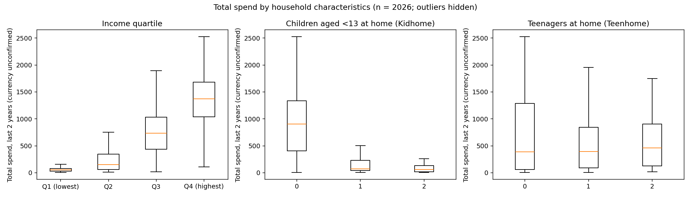
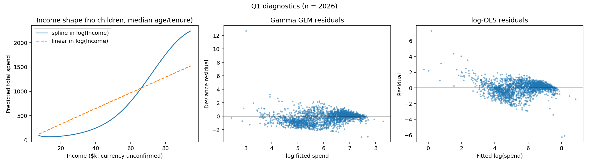
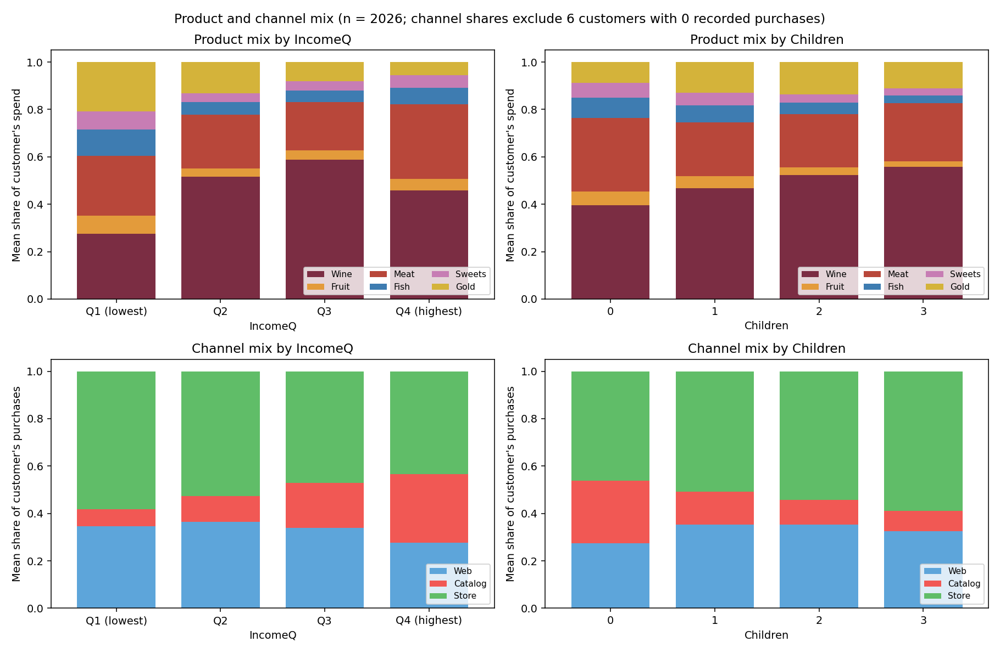
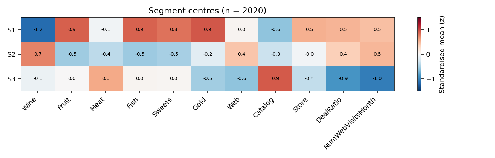
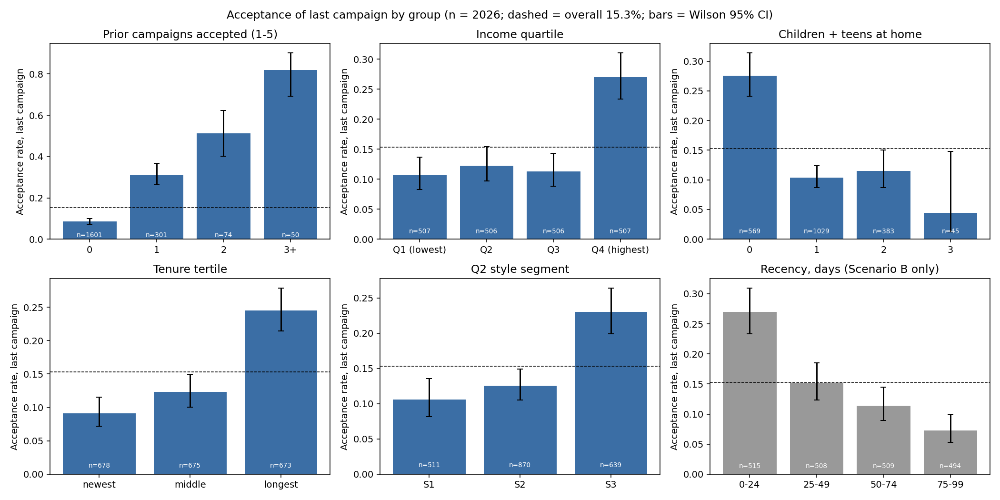
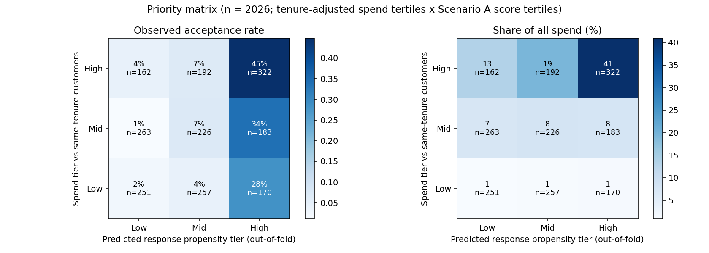
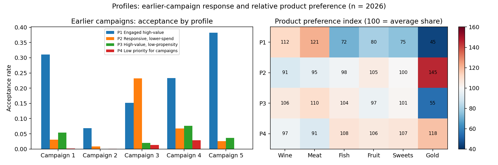
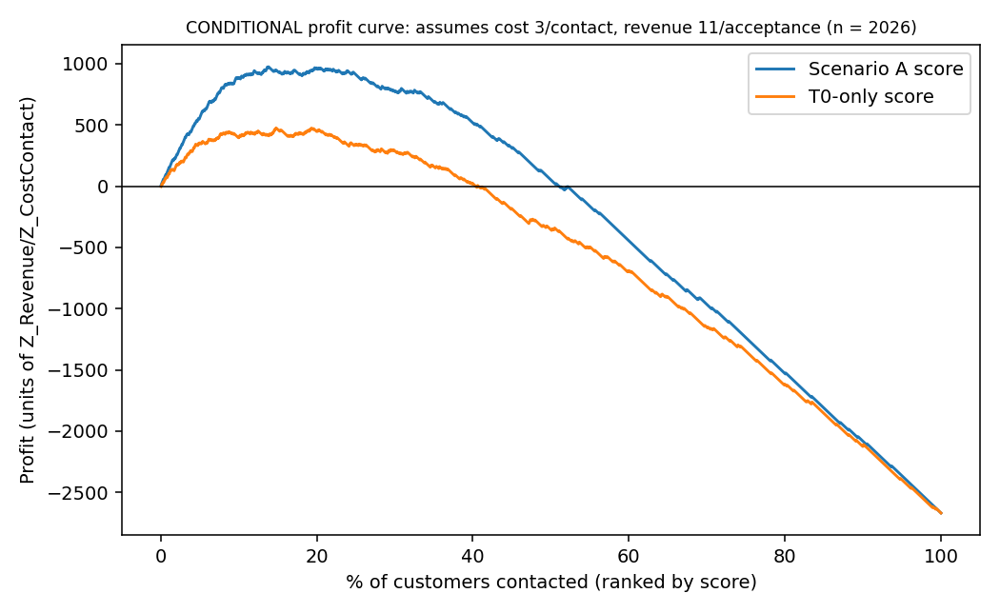

# Customer Personality Analysis: Consultant Report (Revised)

*Prepared for the client's marketing team. Revision 2, which incorporates the client review. Every number in this report is produced by the analysis scripts; Appendix D maps each table and figure to its source file.*

---

## 1. Executive summary

**Bottom line.** For campaigns similar to the most recent one, focus outreach on about one-third of customers. The table below sets out who to contact and how.

| Profile | Share of customers | Accepted last campaign | Share of all acceptors | Share of all spending | What to do |
|---|---|---|---|---|---|
| **P1 Engaged high-value** | 15.9% | **44.7%** | 46.5% | 40.9% | **Top priority.** Include in every comparable campaign. Lead with wine/meat assortment through catalog and store, not discounts.* |
| **P2 Responsive, lower-spend** | 17.4% | **31.2%** | 35.5% | 8.9% | **Second priority, cheap channels.** Email/web offers with a deal element.* |
| **P3 High-value, low-response** | 17.5% | 5.6% | 6.5% | 32.7% | **Do not use this campaign type.** Run a small randomised pilot of a different offer; the campaign 4 offer type is the lead candidate. |
| **P4 Low priority** | 49.2% | 3.6% | 11.6% | 17.5% | **Deprioritise** paid outreach. Treat new customers in this group through a separate onboarding track. |

*\* Channel and offer suggestions are hypotheses drawn from purchase patterns. Test them before rolling out.*

**Key findings:**

1. **How to pick customers without a statistical model.** A six-question **scorecard** (Section 6.3) can be filled in from the CRM in Excel.
   - Contacting the top 20% by scorecard points reaches about **60% of acceptors**, against 20% for random selection. The full model reaches 64%.
   - The simplest usable rule, "contact anyone who accepted any earlier campaign", flags 21% of customers. That group has a 40.7% acceptance rate and contains 56% of all acceptors.
2. **Spending depends mainly on income and young children at home.** Together these account for about 90% of the spending differences our model can explain. Education and marital status add almost nothing once income is known.
   - Each young child at home is associated with roughly **40% lower** spending.
   - Spending rises steeply between incomes of about 40k and 80k.
   - The top 20% of customers produce 52% of all spending.
3. **The best predictor of accepting an offer is having accepted one before.** Also associated with acceptance: longer time as a customer, being single, holding a PhD, and having no teenagers at home.
4. **Different campaigns appealed to different customers.** P1 responded to campaigns 1, 4, 5 and the last one. P2 responded mainly to campaign 3 (23%) and the last one. Campaign 4 was the only offer P3 accepted at the average rate. Matching offer type to profile is therefore likely to matter as much as choosing whom to contact.
5. **New customers (joined in the last 6 months, 26% of the base) need their own track.** They accepted the last offer less often (9.4% vs 17.4%). The scorecard still ranks them well: the top-scoring fifth of new customers contains about 69% of new-customer acceptors.
6. **Measure what campaigns actually cause.** In the next campaign, randomly withhold the offer from 10–20% of P1 and P2. All results here show who *accepts*, not who buys *because of* the campaign.

**What the client must confirm before full roll-out.** The data do not say whether spending, purchase counts and "days since last purchase" were recorded before or after the last campaign. We therefore left "days since last purchase" out of every recommendation. The scorecard for new customers (Scorecard N) uses only information that is always available and can be used immediately. The main scorecard and profiles become fully decision-ready once the client confirms this timing.

---

## 2. Background, questions and how to read this report

The client wants to replace broad campaigns with focused, evidence-based targeting. The four questions are:

1. Which demographic and household characteristics are associated with higher overall spending?
2. How do purchasing patterns, product preferences and shopping channels differ across customers?
3. Which characteristics and behaviours are associated with a greater likelihood of accepting a campaign?
4. Which customer profiles should future marketing prioritise?

Each key finding carries one of three labels:

- **[Descriptive]**: a pattern seen in the data, with no adjustment for other factors.
- **[Robust association]**: the pattern holds after accounting for other customer characteristics and across our sensitivity checks.
- **[Decision-ready]**: robust, uses only information known before a campaign is sent, and checked on customers who were not used to build the tool.

**Plain-language terms used in this report:**

- **Acceptance rate:** the share of customers who accepted the offer.
- **Ranking accuracy (AUC):** the probability that a randomly chosen acceptor scores higher than a randomly chosen non-acceptor. 0.5 is a coin flip; 1.0 is perfect.
- **Capture at 20%:** the share of all acceptors found by contacting the 20% of customers with the highest scores.
- **Tested on held-out customers:** performance measured on customers that the tool was not built from. We split customers into five parts, built the tool on four and tested on the fifth, rotating and repeating this five times.

---

## 3. Data and cleaning

The dataset has one row per customer (2,240 rows) covering:

- demographics and household: birth year, education, marital status, household income, children and teenagers at home;
- enrolment date;
- 2-year spending on wine, meat, fish, fruit, sweets and gold;
- purchases by channel (web, catalog, store), deal purchases, monthly web visits;
- complaints;
- acceptance of five earlier campaigns and of the most recent one.

| Cleaning step | Removed | Remaining |
|---|---|---|
| Raw data | — | 2,240 |
| Missing income | 24 | 2,216 |
| Implausible birth year (1893, 1899, 1900) | 3 | 2,213 |
| Income recorded as 666,666 | 1 | 2,212 |
| Marital status "Absurd"/"YOLO" | 4 | 2,208 |
| Duplicate records (identical on every field except ID) | 182 | **2,026 analysed** |

**Further cleaning decisions:**

- **Recoding:**
  - Married/Together → *Partnered*.
  - Single/Divorced/Widow/Alone → *Single*.
  - "2n Cycle" education → *Master* (an assumption).
- **Flagged records:** seven customers with income above 150k have implausible spending patterns. They are flagged and kept; a sensitivity check drops them.
- **Removed columns:** two fields, `Z_CostContact` = 3 and `Z_Revenue` = 11, are the same for everyone and undocumented. They are used only in the conditional profit scenario (Section 6.6).
- **Duplicates:** we analyse one row per duplicate group, because keeping copies would overstate how well the scoring tools perform. All headline results were re-checked with the duplicates kept (Appendix A).

**Tenure-adjusted value (new in this revision).** Every customer joined less than two years before the latest enrolment date, so "spending in the last 2 years" partly reflects how long someone has been a customer. For Q4 we therefore rank each customer's spending **against customers who joined in the same 6-month window**. This needs no assumption about the unknown data-extraction date.

---

## 4. Methods (summary)

- **Q1 Spending.**
  - Group comparisons.
  - Regression of spending on household characteristics.
  - A relative-importance ranking that shares the explained variation fairly among correlated characteristics.
  - Income is modelled as a smooth curve because its effect is strongly non-linear.
- **Q2 Patterns.**
  - Product and channel mixes by income and household.
  - **Style segmentation** that groups customers by *how* they shop (product mix, channel mix, deal use, web visits). It deliberately ignores *how much* they spend.
  - A product preference index.
  - A look at complaints and web visits.
- **Q3 Response.**
  - Acceptance rates with 95% confidence intervals.
  - A regression that shows each characteristic's association with acceptance while holding others fixed.
  - Scoring models tested on held-out customers.
- **Q4 Priorities.**
  - Cross tenure-adjusted value with predicted acceptance to form four profiles.
  - Convert the model into a points-based scorecard and simple rules.
  - Analyse new customers and the P3 group separately.
- **Information available at decision time.** Each variable was classed by whether it would be known before a future campaign is sent:
  - always known: demographics and tenure;
  - known only if recorded before the campaign: spending and purchase counts;
  - possibly affected by the campaign itself: days since last purchase.
  - **Primary results exclude "days since last purchase".** Results that include it are shown separately as "Scenario B".
- Technical details are in Appendix C.

---

## 5. Findings

### 5.1 Q1: Who spends more?

Spending is very uneven. The top 20% of customers account for **52.3%** of all spending and the top 10% for 30.2% `[Descriptive]`.

*Figure 1. Total 2-year spending by income quartile, young children (Kidhome) and teenagers (Teenhome); n = 2,026.*

| Group | Median 2-year spend | n |
|---|---|---|
| Income quartile 1 → 4 | 53 → 149 → 733 → 1,370 | ≈ 506 each |
| 0 / 1 / 2 young children | 902 / 72 / 61 | 1,168 / 817 / 41 |
| 0 / 1 / 2 teenagers | 388 / 395 / 459 | 1,044 / 933 / 49 |

**Associations after accounting for the other characteristics** `[Robust association]`:

| Characteristic | Recommended estimate (95% CI) | Range across model forms |
|---|---|---|
| Each young child at home | **−38.5%** (−42.8, −33.9) | −38% to −62% |
| Each teenager at home | **−15.2%** (−20.7, −9.4) | −15% to −22% |
| Income | strongly non-linear (Figure 2) | +10% income ≈ +10% to +19% spend on average |
| Each extra month as a customer | +4.4% (3.9, 4.8) | +4.3% to +4.4% |
| Age, education, marital status | no reliable association | — |

**What this means:**

- **Why these are the recommended estimates.** They come from the model that lets income follow its true curved shape, which fits the data far better than a straight-line version. The larger figures in the "range" column come from simpler models.
- **Income and young children dominate.** Together they account for about 90% of the variation the model explains: income 58.9%, young children 31.5%, out of a total R² of 0.695. Time as a customer adds 5.4%. Education, age, teenagers and marital status each add 2% or less.
- **Income works like a threshold.** Spending is flat at low incomes, climbs steeply between roughly 40k and 80k, and keeps rising above that.
- **Teenagers.** Households with teenagers look similar to others in raw medians. Once we compare like with like, however, they spend about 15% less. Teen households tend to be older and higher-income, which hides the difference in the raw figures.
- **Education** seems to matter in raw figures (Basic-education customers spend far less), but this disappears once income is taken into account.
- These results are unchanged when duplicates are kept or the flagged high-income records are dropped (Appendix A).

*Figure 2. Left: predicted spending across income for a customer with no children and median age and tenure. Right panels: model checks showing why income must be modelled as a curve; n = 2,026.*

### 5.2 Q2: How do purchasing patterns differ?

**Overall mix** `[Descriptive]`:

- Products: wine 46% of the average customer's spending, meat 25%, gold 12%, fish 7%, sweets 5%, fruit 5%.
- Channels: store 50% of purchases, web 33%, catalog 17%.

**Income changes how people shop.** From the lowest to the highest income quartile:

| Measure | Lowest quartile | Highest quartile |
|---|---|---|
| Catalog share of purchases | 7% | 29% |
| Purchases made on deal | 37% | 8% |
| Spend per purchase | 13 | 73 |
| Gold share of spending | 21% | 6% |
| Meat share of spending | — | 32% (highest of any quartile) |

**Families browse more and buy less.** Customers with no children compared with those with three:

| Measure | No children | Three children |
|---|---|---|
| Purchases made on deal | 9% | 43% |
| Web visits per month | 3.5 | 6.3 |
| Spend per purchase | 63 | 23 |
| Purchases | 16.6 | 7.4 |

*Figure 3. Product mix (top) and channel mix (bottom) by income quartile and number of children; n = 2,026.*

**Three shopping styles** `[Descriptive]`. The segmentation is highly reproducible (agreement across 100 resamples: 0.94 on a 0–1 scale). The groups overlap, though, so read them as tendencies:

| | **S1 Value-seeking variety shoppers** | **S2 Wine-focused browsers** | **S3 Affluent catalog buyers** |
|---|---|---|---|
| Size | 511 (25.3%) | 870 (43.1%) | 639 (31.6%) |
| Product mix | Most diversified. Fish, fruit, sweets and gold shares about **2×** average | Wine 63% (index 137) | Meat 32% (index 129), wine 44% |
| Channels | Store 58% | Web 38%, store 50% | Catalog 30% |
| Deal share / web visits | 33% / 6.4 per month | 30% / 6.5 | 9% / 2.8 |
| Mean spend (share of total) | 156 (6.5%) | 449 (31.7%) | 1,190 (61.8%) |
| Household | Younger, lower income, young children | Teenagers; 31% PhD | High income, few children |
| Accepted last campaign | 10.6% | 12.5% | 23.0% |

Shopping style and value line up even though spending was not used to form the groups: 76% of S3 are in the top spending third.

**Product preferences that are useful for offers** `[Descriptive]`:

- **S1 and P2 over-index on gold** (index 185 and 145). Gold-focused promotions fit lower-spend, deal-seeking customers.
- **P1 over-indexes on meat (121) and wine (112).**
- **Share and revenue tell different stories.** P3's *share* of fish is only about average (index 104). In *absolute* terms, however, P3 spends more per head on fish than any other profile (84 vs 80 for P1). High-value customers remain the biggest revenue pool even for niche categories.

**Complaints** `[Descriptive]`. Only 19 customers (0.9%) complained in the last two years. Their acceptance rate (15.8%; CI 5.5–37.6%) is indistinguishable from everyone else's (15.3%). With so few cases, complaints cannot inform targeting; 13 of the 19 complainers fall in P4.

**Website visits** `[Descriptive]`. Visits are a signal of browsing and price-checking, not of value:

- Frequent visitors spend *less* (correlation −0.47 between visits and total spending).
- Frequent visitors do not buy online more often (correlation −0.09 with web purchases).
- Heavy visitors are mostly families using deals: at 9+ visits a month, 38% of purchases are on deal and the median spend is 137.
- That small group (n = 91) accepted the last campaign at 31.9% (CI 23.2–42.0%), double the average. Web-triggered offers for heavy browsers are worth testing.

*Figure 4. What distinguishes the three shopping styles (standardised averages; red = above average, blue = below); n = 2,020.*

### 5.3 Q3: Who is more likely to accept a campaign?

**Acceptance rates** `[Descriptive]`. The overall rate for the last campaign was 15.3% (310 of 2,026):

| Group | Acceptance rate |
|---|---|
| Earlier campaigns accepted: 0 / 1 / 2 / 3+ | 8.6% / 31.2% / 51.4% / **82.0%** |
| Highest income quartile vs the other three | 27.0% vs 10.7–12.3% |
| No children at home vs any | 27.6% vs 4.4–11.5% |
| Longest-tenured third vs newest third | 24.5% vs 9.1% |
| Single vs Partnered | 22.5% vs 11.3% |
| PhD vs Graduation | 20.8% vs 13.9% |

*Figure 5. Last-campaign acceptance by group, with 95% confidence intervals; n = 2,026. "Days since last purchase" is greyed out because its timing is unconfirmed.*

**Holding other characteristics fixed** `[Robust association]`:

| Characteristic | Change in acceptance probability (95% CI) |
|---|---|
| Each earlier campaign accepted | **+12.8 points** (odds × 4.0) |
| Single vs Partnered | **+10.2 points** (odds × 3.0) |
| PhD vs Graduation | +6.6 points |
| Each month as a customer | +1.0 point |
| Each teenager at home | **−7.9 points** (odds × 0.42) |

**Reading the adjusted results:**

- These hold in every sensitivity check.
- **Income and young children add little once spending is known**, because they are closely tied to spending.
- **About "days since last purchase" (recency).** Customers who bought within the last 25 days accepted at 27.0%, against 7.3% for those at 75–99 days. If the client confirms that recency was recorded *before* the campaign, it would raise ranking accuracy from 0.86 to about 0.89 and become a valuable targeting variable. Until then we do not rely on it.

**How well can acceptance be predicted?** All figures below are tested on held-out customers; overall rate 15.3%.

| Information used | Ranking accuracy | Acceptance among top 10% | Capture at 20% |
|---|---|---|---|
| Demographics + tenure only | 0.755 | 45.3% | 48.7% |
| **+ purchase history + earlier campaigns (primary)** | **0.858** | **67.0%** | **63.9%** |
| + recency (Scenario B, needs confirmation) | 0.894 | 70.4% | 68.7% |

A simpler logistic model matched a more complex machine-learning model (0.858 vs 0.852), so we use the simpler one.

---

## 6. Q4: Recommendations

### 6.1 Priority matrix and profiles

We crossed **tenure-adjusted spending** (spend relative to customers who joined in the same 6-month window) with **predicted acceptance**. Each dimension is split into thirds.

*Figure 6. Acceptance rate (left) and share of all spending (right) in each value × predicted-acceptance cell; n = 2,026.*

**Profile cards** `[Robust association]`:

| | **P1 Engaged high-value** | **P2 Responsive, lower-spend** | **P3 High-value, low-response** | **P4 Low priority** |
|---|---|---|---|---|
| Definition | High value × high predicted acceptance | Low/mid value × high predicted acceptance | High value × low/mid predicted acceptance | Low/mid value × low/mid predicted acceptance |
| Size | 322 (15.9%) | 353 (17.4%) | 354 (17.5%) | 997 (49.2%) |
| Accepted last campaign (95% CI) | **44.7%** (39.4–50.2) | **31.2%** (26.6–36.2) | 5.6% (3.7–8.6) | 3.6% (2.6–5.0) |
| Share of acceptors / spending | 46.5% / 40.9% | 35.5% / 8.9% | 6.5% / 32.7% | 11.6% / 17.5% |
| Typical customer | Income ≈ 76k; almost no young children; 48% single; 1.1 earlier acceptances; 14 months as customer | Income ≈ 40k; young children common; 62% single; longest tenure (16 months) | Income ≈ 71k; teenagers at home; 75% partnered; 34% joined in the last 6 months | Income ≈ 42k; children and teenagers; 33% joined in the last 6 months |
| Channels | Catalog 31% / store 40% / web 30% | Web 40% / store 46%; 7.3 web visits a month | Store 46% / catalog 26% | Store 57% |
| Deal use | 10% of purchases | 33% | 11% | 31% |
| Product preference index | Meat 121, wine 112 | Gold 145 | Close to average (gold 55) | Gold 118, fish 108 |
| Earlier campaigns that worked | 1, 4, 5 and the last (23–45%) | Campaign 3 (23%) and the last | Campaign 4 only (7.6%, the overall average) | None (≤ 3%) |
| **Recommended action** | Include in every comparable campaign. Lead with premium wine/meat assortments by catalog and store, not discounts.* | Low-cost email/web offers with a deal or gold-product element.* Find out what campaign 3 offered. | Do not send the standard offer. Run a randomised pilot built on the campaign 4 offer type. Maintain the relationship through store and catalog. | No paid outreach for this campaign type. New customers here go to the onboarding track (6.4). |

*\* Hypotheses to test, not established effects.*

**Effect of the tenure adjustment.** Compared with the previous version, which used raw 2-year spending, 57 recently joined customers (average 5.9 months) moved from P4 into P3, and P3 grew from 336 to 354. The overall picture is unchanged (Appendix A).

### 6.2 Different campaigns reach different customers

*Figure 7. Left: acceptance of each earlier campaign by profile. Right: product preference index (100 = average share of spending); n = 2,026.*

The five earlier campaigns did not appeal to the same people `[Descriptive]`:

- Campaigns 1 and 5 were accepted almost exclusively by P1.
- Campaign 3 was accepted most by P2 (23.2%).
- Campaign 4 was the only campaign P3 accepted at about the overall rate (7.6% vs 7.7%).

**Recommendation:** the client knows what each campaign offered, so compare the content of campaigns 3 and 4 with the others. Use campaign 3's offer type for P2 and campaign 4's for the P3 pilot. This is the strongest data-based lead we have for reaching P3.

**How P3 differs from P1** (both high value). The large differences are:

| Measure | P1 | P3 |
|---|---|---|
| Earlier acceptances (average) | 1.15 | 0.19 |
| Months as customer | 14.0 | 9.5 |
| Joined in the last 6 months | 17% | 34% |
| Teenagers at home (average) | 0.25 | 0.54 |
| Store share of purchases | 40% | 47% |
| Spend per purchase | 83 | 60 |
| Single | 48% | 25% |

P3 customers buy just as *often* as P1 (about 20 purchases each). They also use deals equally rarely (10–11%) and visit the website as little. P3 is therefore a loyal, store-oriented, family-household group that is *not* price-driven and has simply not been engaged by past offers. Part of P3 is also new. Sending P3 more of the same offer is unlikely to pay off; a different offer, tested on a small randomised group first, is the sensible next step.

### 6.3 Tools the CRM team can use directly

**Scorecard A, for existing customers** `[Robust association; decision-ready once data timing is confirmed]`. Add up the points:

| Question | Answer → points |
|---|---|
| How many earlier campaigns has the customer accepted? | 0 → 0 · 1 → 17 · 2 or more → 31 |
| How long since the customer joined? | 0–6 months → 0 · 6–12 → 2 · 12–18 → 10 · 18–24 → 17 |
| Any teenagers at home? | Yes → 0 · No → 10 |
| Marital status | Partnered → 0 · Single → 10 |
| Education PhD? | No → 0 · Yes → 6 |
| 2-year spending tier | Low third → 0 · Middle or top third → 3 |

| Total points | Share of customers | Acceptance rate (95% CI) | Share of all acceptors |
|---|---|---|---|
| 44 or more | 9.9% | **61.2%** (54.3–67.7) | 39.7% |
| 34–43 | 10.1% | 31.9% (25.9–38.5) | 21.0% |
| 31–33 | 3.3% | 28.8% | 6.1% |
| 22–30 | 25.9% | 12.6% | 21.3% |
| 21 or fewer | 50.8% | 3.6% | 11.9% |

**Suggested cut-off:** contact customers with **34+ points** (about 20% of customers). Tested on held-out customers, the scorecard's ranking accuracy is **0.831** and it captures **60.1%** of acceptors at 20% contact. The full model scores 0.858 and 63.9%, so very little accuracy is lost by using the simpler tool.

**Scorecard N, for new customers or when campaign history is unavailable** `[Decision-ready]`. It uses only always-available information: tenure, teenagers, young children, marital status, PhD and income quartile (point values in Appendix B). It has a ranking accuracy of 0.756 and captures 47.1% of acceptors at 20% contact (held-out).

**One-line rules** `[Descriptive]`. These rules were written from the findings on the same data, so expect slightly weaker results in future:

| Rule | Customers flagged | Acceptance rate | Share of acceptors | Model at the same volume |
|---|---|---|---|---|
| R1: accepted any earlier campaign | 21.0% | 40.7% | 55.8% | 65.2% |
| R4: R1, OR top-third spender with no teenagers | 32.2% | 33.1% | 69.7% | 80.0% |
| R2: R1, OR no teenagers and 12+ months as customer | 38.9% | 29.8% | 75.8% | 86.1% |

**Which tool to use:**

- Rules are the easiest to apply but miss about 10 percentage points of acceptors compared with the model.
- **The scorecard is the recommended operational tool.**
- The model is best if the analytics team can run it.

### 6.4 New customers: a separate onboarding track

Customers who joined in the last 6 months (522, 25.8%) differ from the rest `[Descriptive]`:

| Measure | New customers | Everyone else |
|---|---|---|
| Accepted the last offer | 9.4% (7.2–12.2) | 17.4% (15.5–19.4) |
| Median spend so far | 178 | 445 |
| In the top third of value *relative to their joining cohort* | 33% | 33% |
| Classified as P4 | 62% | 45% |

Because time as a customer is one of the strongest predictors, a single ranking pushes new customers to the bottom. **Recommendation: set a separate contact quota for new customers and rank them against each other.**

- The top 20% of new customers by Scorecard A contains **69.4%** of new-customer acceptors, with a 32.7% acceptance rate. This figure uses scorecard points fitted on all customers, so it is slightly optimistic.
- New customers without any campaign history should be scored with Scorecard N.

### 6.5 How many customers to contact

All figures are tested on held-out customers; 95% intervals in brackets.

| Contact the top… | Share of acceptors reached | Acceptance rate | Using demographics only |
|---|---|---|---|
| 10% | 43.9% (39.9–48.0) | 67.0% | 29.7% reached |
| 20% | 63.9% (58.7–68.9) | 48.9% | 48.7% |
| 30% | 76.1% (71.8–81.0) | 38.8% | 61.9% |
| 50% | 90.6% (87.4–93.8) | 27.7% | 78.7% |
| Everyone | 100% | 15.3% | 100% |

### 6.6 Conditional profit scenario (requires client confirmation)

*This scenario applies only if* `Z_CostContact` = 3 is the cost per contact and `Z_Revenue` = 11 is the revenue per acceptance. A contact then pays off only when the acceptance chance exceeds 3/11 ≈ 27%. Under that assumption:

- contacting everyone would have lost 2,668 units;
- contacting the top ≈ 14% by score would have earned +975 units (58.9% acceptance);
- the demographics-only score would have earned +475 units at best.

These figures have not been validated on a future campaign.

*Figure 8. Profit by share of customers contacted, conditional on the cost and revenue assumption above; n = 2,026.*

### 6.7 Validation design for the next campaign

1. Score all customers with Scorecard A, or Scorecard N for new customers.
2. In P1 and P2, randomly withhold the offer from 10–20%.
3. Send a small randomised pilot to P3, using the campaign 4 offer type, and to a random sample of P4.
4. Compare purchases of contacted and withheld customers within each profile.

The difference shows the **extra** purchases caused by the campaign, which is the figure that should set future budgets.

---

## 7. Limitations

1. **Unknown timing of the behaviour data.** If spending, purchase counts or recency were recorded *after* the last campaign, a customer's own acceptance may have inflated them. Recency is excluded from all recommendations; spending and purchase counts carry a smaller version of the same risk.
2. **Time as a customer versus the 2-year window.** Every customer joined less than two years before the latest enrolment date. We adjusted value for this in Q4. Q1 and Q3 include tenure as a control.
3. **Duplicates.** 358 records (176 groups) are identical except for ID. We treated them as duplicate entries; results with and without them agree.
4. **Campaigns differ in unknown ways.** Acceptance ranged from 1.3% (campaign 2) to 15% (last campaign), and different profiles responded to different campaigns. Our tools describe response to campaigns *like the last one*.
5. **No randomisation.** It is unknown who was contacted. A non-acceptance may mean "not offered". Customers likely to accept are not necessarily customers whose purchases the campaign causes.
6. **Age and representativeness.** Enrolments are from 2012–2014, and it is unknown whether these customers represent today's base.
7. **Small groups.** Basic education (49), three children (45), two young children (41), complaints (19) and 9+ web visits (91) give imprecise estimates.
8. **Many comparisons.** Single descriptive differences are exploratory. Our recommendations rest on large, consistent effects confirmed after adjustment.
9. **Privacy.** Household composition and marital status are sensitive targeting variables. Behaviour-based signals (earlier acceptance, tenure, channel use) are stronger and less sensitive. Scorecard A relies mostly on them.

---

## 8. Questions for the client

1. On what date were "days since last purchase", spending, purchase counts and web visits recorded? Was it before or after the last campaign?
2. When did campaigns 1–5 and the last campaign run, and **what did each offer, through which channel?** Campaigns 3 and 4 are of particular interest.
3. Was every customer contacted in every campaign?
4. What counts as "accepted"? Are acceptance purchases included in spending and deal counts?
5. Are the 176 groups of identical records duplicates of the same customers?
6. What do `Z_CostContact` (3) and `Z_Revenue` (11) mean? What currency are spending and income in?
7. Should value be measured as revenue or margin? Is there a contact budget for the next campaign?
8. Are these customers the full base or a sample?
9. What does "2n Cycle" education mean? Should the seven unusual high-income records be corrected?

---

## Appendix A. Sensitivity analyses

**Q1: estimated effect on spending under different samples**

| Sample | n | Young child (recommended model) | Teenager (recommended model) | Young child (simpler model) | Tenure +1 month |
|---|---|---|---|---|---|
| Primary (deduplicated) | 2,026 | −38.5% | −15.2% | −61.8% | +4.3% |
| Duplicates kept | 2,208 | −37.5% | −14.2% | −60.3% | +4.2% |
| Flagged high-income dropped | 2,019 | −36.9% | −18.9% | −61.7% | +4.3% |

**Q3: primary scoring performance and adjusted associations**

| Sample | Ranking accuracy (logistic / boosting) | Top-10% lift | Odds ratio: earlier acceptance / teen / single |
|---|---|---|---|
| Primary | 0.858 / 0.852 | 4.38 | 4.05 / 0.42 / 3.03 |
| Duplicates kept | 0.863 / 0.864 | 4.59 | 4.14 / 0.42 / 3.10 |
| Flagged high-income dropped | 0.865 / 0.856 | 4.45 | 4.03 / 0.42 / 3.01 |

Keeping duplicates raises the boosting model's accuracy (0.852 → 0.864). This is consistent with duplicate records leaking between the training and test parts, which is why we deduplicated.

**Q4: profiles using raw (not tenure-adjusted) spending**

| | Customers | Acceptance | Share of acceptors | Share of spending |
|---|---|---|---|---|
| P1 | 337 | 45.4% | 49.4% | 42.1% |
| P2 | 338 | 29.9% | 32.6% | 7.7% |
| P3 | 336 | 5.4% | 5.8% | 32.1% |
| P4 | 1,015 | 3.7% | 12.3% | 18.1% |

1,899 of 2,026 customers keep the same profile under both definitions.

**Q4: profiles and targeting tools re-run on each sample.** The full Q4 pipeline (scoring model, tenure-adjusted tiers, profiles, scorecard testing) was repeated on each sample:

| Sample | P1 / P2 / P3 / P4 share of acceptors | P1 acceptance | Model capture at 20% | Scorecard A capture at 20% | Scorecard N accuracy |
|---|---|---|---|---|---|
| Primary | 46.5 / 35.5 / 6.5 / 11.6% | 44.7% | 63.9% | 60.1% | 0.756 |
| Duplicates kept | 47.7 / 34.4 / 5.4 / 12.4% | 44.3% | 64.7% | 60.9% | 0.757 |
| Flagged high-income dropped | 47.1 / 34.2 / 5.8 / 12.9% | 44.4% | 63.9% | 60.1% | 0.755 |

No profile share moves by more than 1.3 percentage points.

## Appendix B. Scorecard N points

| Question | Answer → points |
|---|---|
| Months since joining | 0–6 → 0 · 6–12 → 1 · 12–18 → 8 · 18–24 → 15 |
| Teenagers at home | Yes → 0 · No → 10 |
| Young children at home | No → 0 · Yes → 1 |
| Marital status | Partnered → 0 · Single → 9 |
| PhD | No → 0 · Yes → 6 |
| Income quartile | Lowest → 0 · 2nd → 5 · 3rd → 6 · Highest → 13 |

| Total points | Share of customers | Acceptance rate | Share of all acceptors |
|---|---|---|---|
| 37 or more | 9.6% | 46.9% | 29.4% |
| 32–36 | 7.5% | 31.1% | 15.2% |
| 28–31 | 11.6% | 19.7% | 14.8% |
| 22–27 | 20.5% | 16.1% | 21.6% |
| 21 or fewer | 50.9% | 5.7% | 19.0% |

**How the scorecards were built:**

- Points are 10 × the logistic-regression coefficient, rounded, with the lowest answer set to 0.
- Held-out performance re-derives the points in each training part.
- Scorecard A originally included young children. That item earned points only because spending is also in the card, which would confuse field users. We removed it: ranking accuracy changed from 0.837 to 0.831, and capture at 20% from 59.3% to 59.9%.
- A depth-3 decision tree, tested on held-out customers (accuracy 0.774), confirmed that earlier acceptance and tenure are the leading splits.

## Appendix C. Technical details

- **Q1 models.**
  - Primary: Gamma GLM (log link) with HC3 robust standard errors.
  - Recommended estimates replace log income with a B-spline (4 df). The fit improves markedly: deviance 846 vs 1,495.
  - Robustness model: OLS on log spend.
  - The Gamma model was fitted by Newton's method from a smearing-adjusted OLS start, because the default IRLS stopped at a worse solution.
  - Relative importance: Shapley R² decomposition of the log-OLS model.
  - Variance inflation factors ≤ 1.43.
  - Income × young-children interaction: p = 0.068 (not used).
- **Q2 segmentation.**
  - K-means (50 starts) on 11 standardised composition features.
  - k = 3 chosen by silhouette (0.207, the best of k = 3–5) and minimum segment size.
  - Stability: bootstrap adjusted Rand index 0.94 (5th–95th percentile 0.90–0.97).
- **Q3 models.**
  - Explanatory logistic regression with HC1 standard errors; average marginal effects.
  - Predictive comparison: L2 logistic regression versus histogram gradient boosting (depth 3, learning rate 0.05, 300 iterations, untuned).
  - Testing: 5×5 repeated stratified cross-validation, seed 503. Top-decile and budget figures use held-out scores averaged over the five repeats, with bootstrap CIs.
- **Q4.**
  - Tenure-adjusted value tier: the percentile of spending within 6-month tenure bands, split into thirds.
  - Predicted-acceptance tier: thirds of the held-out primary-model score.
- **Reproducibility.** `python run_all.py` from the repository root runs every analysis in dependency order. Each script writes into the `output/` and `figures/` folders of its report section, then the summary figures and both report HTML files are rebuilt.

## Appendix D. Source map

Folders mirror this report's sections. Each folder holds `code/`, `output/` (result tables and logs) and `figures/`.

| Report element | Folder → output file |
|---|---|
| Cleaning table | `01_Dataset/output/00_cleaning_log.txt` |
| Q1 tables and Figures 1–2 | `04_Results/Q1_Spending/output/`: `q1_descriptives.csv`, `q1_effects.csv`, `q1_shapley_r2.csv`, `q1_sensitivity.csv` |
| Q2 segments, mixes, Figures 3–4 | `04_Results/Q2_Patterns/output/`: `q2_segment_profiles.csv`, `q2_segment_by_spendtier.csv`, `q2_k_selection.csv` |
| Product index by segment, complaints, web visits | `04_Results/Q2_Patterns/output/`: `q2b_product_index_segment.csv`, `q2b_web_visits.csv`, `q2b_results.txt` |
| Q3 rates, associations, performance | `04_Results/Q3_Response/output/`: `q3_rates.csv`, `q3_logit_explanatory.csv`, `q3_model_performance.csv`, `q3_sensitivity.csv` |
| Profiles and matrix (Figure 6) | `04_Results/Q4_Priorities/output/`: `q4_profiles.csv`, `q4_priority_matrix.csv`, `q4_profiles_unadjusted.csv`, `q4_profile_change.csv` |
| Campaign × profile, P3 vs P1, product index by profile (Figure 7) | `04_Results/Q4_Priorities/output/`: `q4b_campaign_by_profile.csv`, `q4b_P3_vs_P1.csv`, `q4b_product_index.csv` |
| Scorecards, rules, new customers | `04_Results/Q4_Priorities/output/`: `q4b_scorecards.csv`, `q4b_scorecard_performance.csv`, `q4b_scorecard_bands.csv`, `q4b_rules.csv`, `q4b_new_customers*.csv` |
| Budget and profit tables (Figure 8) | `04_Results/Q4_Priorities/output/`: `q4_budget_table.csv`, `q4_profit_conditional.csv` |
| Sensitivity analyses (Appendix A) | `03_Methods/Robustness/output/q4c_*`, plus `q1_sensitivity.csv` and `q3_sensitivity.csv` |
| Challenges (duplicates, model fitting, tenure, timing) | `05_Challenges/output/` |

## Appendix E. Response to client review

| Client request | Change made |
|---|---|
| 1. Give rules the CRM team can run without the model | New Section 6.3: Scorecard A (6 questions, accuracy 0.831, captures 60% of acceptors at 20% contact), Scorecard N for new customers, and three one-line rules compared with the model. |
| 2. Adjust value tiers for tenure | Q4 now uses spending relative to customers who joined in the same 6-month window. 57 recent joiners moved from P4 to P3. New Section 6.4 sets up a separate track for new customers. |
| 3. Give concrete guidance for P3 | New Section 6.2: P3 vs P1 comparison, and acceptance of each earlier campaign by profile. Campaign 4 is identified as the lead candidate for a randomised P3 pilot. |
| 4. Business language, profile cards, no file references | Rewritten executive summary, profile cards (6.1), plain-language terms box (Section 2), file references moved to Appendix D. |
| Product guidance beyond wine and meat | Product preference index by profile and segment, in both share and absolute spending. |
| Complaints, web visits, recency | Explicit findings in Sections 5.2 and 5.3. |
| One citable figure for the young-children effect | −38.5% from the best-fitting model; the range appears alongside. |
