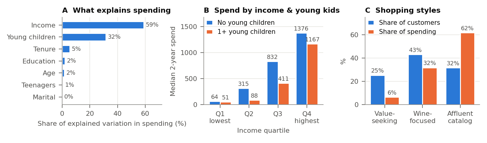
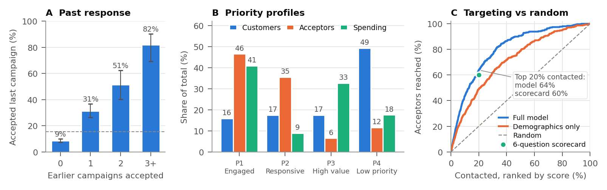

# Customer Personality Analysis: Consultant Team Summary

*Consultant team report · Client: retail company, marketing department*

## Dataset

The public *Customer Personality Analysis* dataset (Kaggle) has one row for each of 2,240 customers. Its 29 fields cover demographics and household (birth year, education, marital status, income, children and teenagers at home), enrolment date (2012–2014), two-year spending on wine, meat, fish, fruit, sweets and gold, purchases by web, catalog and store, deal purchases, web visits, recency, complaints, and acceptance of five earlier campaigns and the most recent one (15% accepted). After removing 32 rows with missing or implausible values (e.g. birth year 1893, income 666,666) and collapsing **182 duplicate records**, **2,026 customers** remained.

## Goals and questions

The client wants to replace broad campaigns with focused targeting. They asked four questions: (1) Who spends more? (2) How do purchasing patterns, products and channels differ? (3) Who is more likely to accept a campaign? (4) Which profiles should be prioritised? Each finding is labelled **[Descriptive]** (a pattern in the data), **[Robust]** (holds after adjustment and across sensitivity checks), or **[Decision-ready]** (robust, uses only information available before a campaign, and validated on held-out customers).

## Methods

- **Q1.** Regression comparing otherwise-similar customers, with income modelled as a curve, plus each characteristic's share of the explained variation.
- **Q2.** Product and channel mixes by group. Customers were clustered by *how* they shop (product mix, channels, deal use, web visits), not by how much they spend.
- **Q3.** Acceptance rates, a regression holding other traits fixed, and scoring models tested on customers not used to build them. *Recency* was excluded because accepting the offer could have changed it.
- **Q4.** Value (spending relative to same-cohort customers) crossed with predicted acceptance to form four profiles, then a six-question points scorecard.
- **Robustness.** All headline results, including profiles and scorecards, were re-run with duplicates kept and outliers removed.

## Results

*Figure 1. (A) Share of explained variation in spending. (B) Median two-year spend by income quartile and young children. (C) Share of customers and of spending by shopping style. n = 2,026.*

**Q1: Spending.**

- Income and young children account for about 90% of the variation our model explains (Fig. 1A); education and marital status show no reliable association. [Robust]
- At every income level, households with young children spend less (Fig. 1B). Each young child is associated with **≈ 38% lower spending** (95% CI −43% to −34%) and each teenager with ≈ 15% lower. [Robust]
- The top 20% of customers produce 52% of spending. [Descriptive]

**Q2: Patterns.** Three stable shopping styles emerged (Fig. 1C) [Descriptive]: *value-seeking variety shoppers* (deal-heavy; about twice the average share of fish, fruit, sweets and gold), *wine-focused browsers* (63% of spending on wine) and *affluent catalog buyers* (32% of customers, 62% of spending). Customers with two or more children make about 43% of purchases on deals, compared with 9% for customers without children. Web visits signal browsing, not value: the correlation with spending is −0.47.

*Figure 2. (A) Acceptance by earlier campaigns accepted (95% CIs; dashed line = 15% average; n = 1,601 / 301 / 74 / 50). (B) Profile shares of customers, acceptors, spending. (C) Acceptors reached by contacting in score order (held-out). n = 2,026.*

**Q3: Response.**

- Acceptance rises from 9% to 82% with the number of earlier campaigns accepted (Fig. 2A). [Robust]
- Holding other factors fixed, acceptance is higher for single customers (+10 points), PhD holders (+7) and longer-tenured customers, and lower with teenagers at home (−8). [Robust]
- The scoring model ranks customers well: AUC 0.86, and its top decile accepted at 67%. [Decision-ready once the client confirms the behaviour data precede the campaign]

**Q4: Priorities** (Fig. 2B).

| Profile | Customers | Accepted | Share of acceptors | Share of spending | Suggested action* |
|---|---|---|---|---|---|
| P1 Engaged | 15.9% | 44.7% | 46.5% | 40.9% | Top priority; assortment-led catalog/store offers |
| P2 Responsive | 17.4% | 31.2% | 35.5% | 8.9% | Low-cost web/email offers with a deal |
| P3 High value | 17.5% | 5.6% | 6.5% | 32.7% | Skip the standard offer; small randomised pilot |
| P4 Low priority | 49.2% | 3.6% | 11.6% | 17.5% | No paid outreach; onboard new customers |

*\*Profiles are [Robust]: with duplicates kept or outliers removed, no share moves by more than 1.3 points. Channel and offer suggestions are hypotheses to test.*

- **Budget and scorecard.** Contacting the top 20% by model score reaches 64% of acceptors (49% acceptance), and the top 30% reaches 76% (Fig. 2C). The six-question scorecard reaches **60%** at 20% contact (60–61% across sensitivity samples). [Decision-ready once data timing is confirmed]
- **Usable now.** A demographics-only scorecard (AUC 0.76; 47% of acceptors at 20% contact). [Decision-ready]
- **Offers.** Campaign 3 was accepted by 23% of P2. Campaign 4 was the only one P3 accepted at about the average rate (7.6% vs 7.7%). Offer content should therefore be tested by profile. [Descriptive]
- **We need from the client:** (1) when the behaviour fields were recorded; (2) what campaigns 3 and 4 offered; (3) what the Z_CostContact/Z_Revenue fields mean; (4) a random 10–20% hold-out of P1/P2 in the next campaign to measure true uplift.

## Challenges

- **Undocumented timing.** We do not know whether the behaviour fields were recorded before the last campaign, so recency was kept out of all recommendations.
- **Duplicates.** The 358 duplicate records inflated accuracy (AUC 0.852 → 0.864) until they were removed.
- **Tenure and usability.** Raw spending partly reflects tenure (+4% per month); we built a tenure-adjusted value measure and an Excel-ready scorecard.

## Limitations

- **Association, not causation.** Campaigns were not shown to be randomised, so high predicted acceptance does not mean the campaign *causes* purchases.
- **Possible leakage.** If behaviour fields post-date the campaign, the behaviour-based scores are optimistic.
- **Generalisability.** The results apply to offers like the last one, and the 2012–14 data may not reflect today's customers.
- **Precision and costs.** Small groups (e.g. 19 complainers) make some differences exploratory; costs are undocumented, so no profit figures are given.
